<p align="center">
  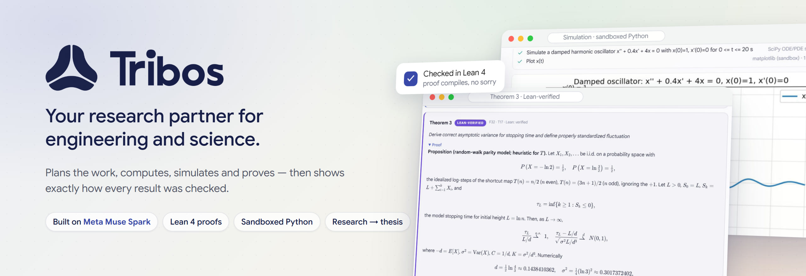
</p>

<p align="center">
  <a href="#see-it-work"><b>Demo</b></a> &nbsp;·&nbsp;
  <a href="#what-tribos-does"><b>Features</b></a> &nbsp;·&nbsp;
  <a href="#built-on-meta-muse-spark"><b>Meta models</b></a> &nbsp;·&nbsp;
  <a href="#how-it-works"><b>How it works</b></a> &nbsp;·&nbsp;
  <a href="#quick-start"><b>Quick start</b></a> &nbsp;·&nbsp;
  <a href="docs/index.md"><b>Docs</b></a>
</p>

<p align="center">
  
  
  
  
  
  
</p>

---

**Tribos** (*τρίβος*, "a worn path, diligent inquiry") is a research partner for engineering, physics and
mathematics. Ask a question in plain language, or show it a photo of a problem. Tribos plans the work, runs real
tools (computer algebra, numerical solvers, a Python sandbox, physical constants, the literature and a Lean 4 proof
checker), writes the answer with every formula on the page, and tells you **which claims were checked, and how**.

For questions that need more than one answer, Tribos runs a **research project**: round after round of computations,
simulations and proofs until it reaches a conclusion, then writes the result up as a **thesis** you can export.

> Built on **Meta Muse Spark** through the Meta Model API, for the **Meta AI Global Hackathon 2026**.

## See it work

<p align="center">
  <a href="https://github.com/AtlasRoX/TribosAI/releases/tag/demo-video">
    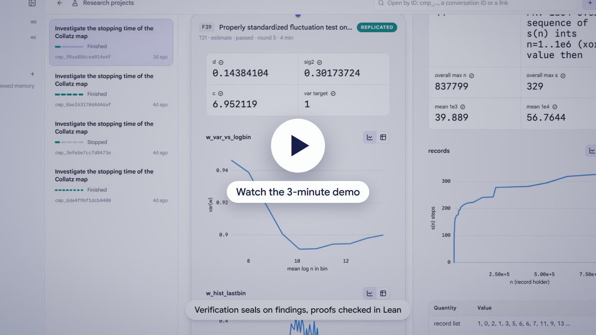
  </a>
  <br>
  <sub>Three minutes, recorded from the running app: an engineering question, a problem read from a photo, a research
  project with a Lean-verified theorem and its thesis, and a simulation you can explore.</sub>
</p>

## What Tribos does

<table>
<tr>
<td width="50%" valign="top">
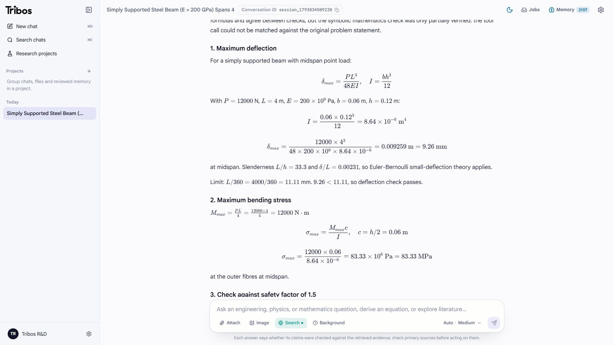
</td>
<td width="50%" valign="top">

### Ask anything

Type an engineering, physics or mathematics question. Tribos routes it, plans the steps and calls the tools that do
the arithmetic, so the answer is **derived, not guessed**:

- every formula and every intermediate number on the page, rendered with KaTeX;
- engineering calculators for beams, columns, pressure vessels (ASME VIII-1), shafts, bolts, fatigue, pipe flow and
  heat exchangers, each with its reference and validity limits;
- unit and dimension checks on the written answer, and every equation in it re-evaluated before you see it;
- a plan panel that shows each step and how it was checked.

</td>
</tr>
<tr>
<td width="50%" valign="top">

### Read a problem from a photo

Attach a picture of a problem. Before anything is solved, Tribos reads it **four ways**: two text recognizers
(Tesseract and Indra OCR) and two separate Muse Spark vision readings. The readings are compared as canonical
LaTeX; when they disagree, a review pass settles the differences and repairs the transcription.

You see the result rendered as math, side by side with the image, with a status line such as *"read by two text
recognizers; two separate vision readings agreed"*, and you can edit it before sending.

</td>
<td width="50%" valign="top">
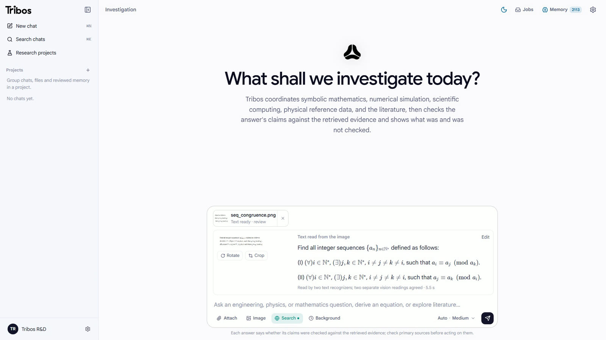
</td>
</tr>
<tr>
<td width="50%" valign="top">
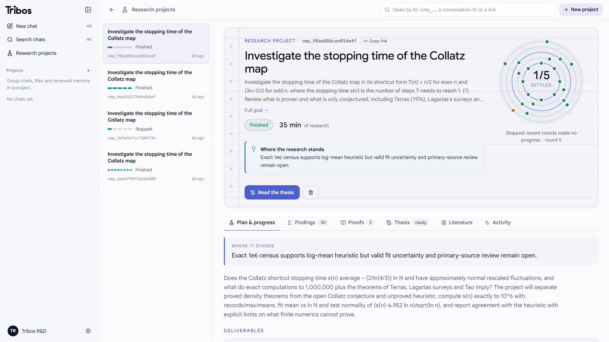
</td>
<td width="50%" valign="top">

### Run a research project

Give Tribos an open question and it works like a lab:

1. **Charter**: deliverables, hypotheses with falsification criteria, and a graph of tests.
2. **Rounds**: tests run in parallel (compute, simulate, prove, literature); failures retry with a different method.
3. **Findings ledger**: every result keeps its numbers, code, plots and a **verification seal**.
4. **Judge**: decides what is done, refuted or still open, under deterministic evidence rules: nothing is marked
   done without a passing finding behind it.
5. **Adaptive stopping**: it stops on a conclusion, on stagnation or at a safety ceiling, and says which.

A live time estimate shows how long the work has left.

</td>
</tr>
<tr>
<td width="50%" valign="top">

### Proofs you can trust

Theorems are formalised in **Lean 4** and repaired until they compile. A result is labelled *Lean-verified* only on a
clean compile with no `sorry`, after an axiom audit (`#print axioms`) that rejects anything beyond Lean's standard
axioms. Everything else is labelled with what it really is: certified by interval or exact arithmetic, replicated by two
independent implementations, computed once, sourced from the literature, or reasoned.

</td>
<td width="50%" valign="top">
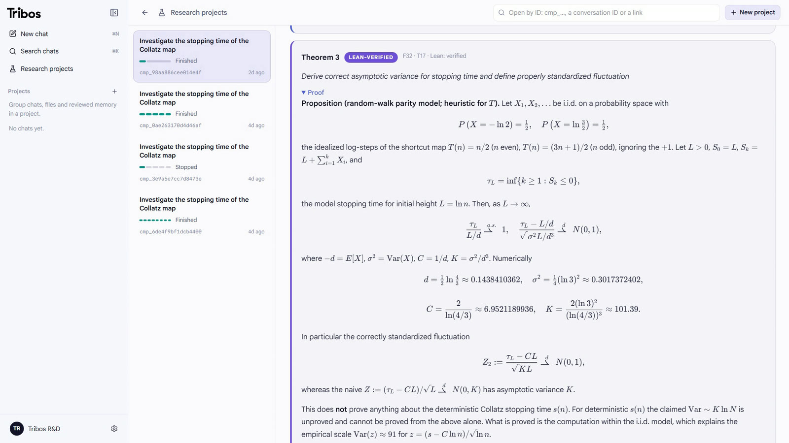
</td>
</tr>
<tr>
<td width="50%" valign="top">
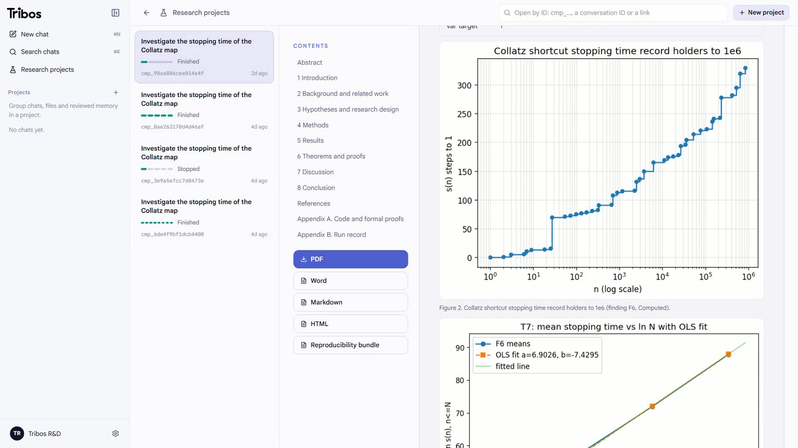
</td>
<td width="50%" valign="top">

### From findings to a thesis

When the work is done, Tribos writes it up chapter by chapter: abstract, background with citations, research design,
methods, results with numbered figures and tables, theorems and proofs, discussion, conclusion with a verdict per
hypothesis, and appendices with the code of every finding.

Every number in the thesis is checked against the findings ledger. Export it as **PDF, Word, Markdown, HTML** or a
**reproducibility bundle** with the code and data.

</td>
</tr>
<tr>
<td width="50%" valign="top">

### Compute and simulate

Describe a simulation and Tribos writes the Python, runs it in a **sandbox** (NumPy, SciPy, SymPy, Pandas, Pint,
Matplotlib) and brings back the plot. The code behind every chart is one click away.

- ODE and PDE solvers with convergence studies and conservation checks;
- an **Explore** panel: trajectories, phase portraits, bifurcation sweeps and parameter changes, live;
- fit models to your own CSV, Excel, HDF5 or MAT data;
- uncertainty propagation (GUM and Monte Carlo) with CODATA constants and units.

</td>
<td width="50%" valign="top">
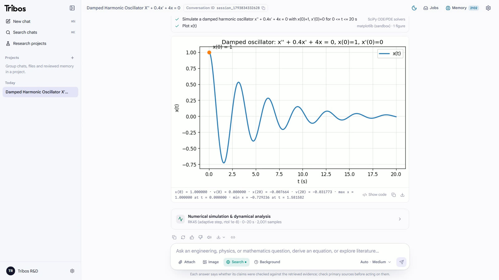
<br><br>
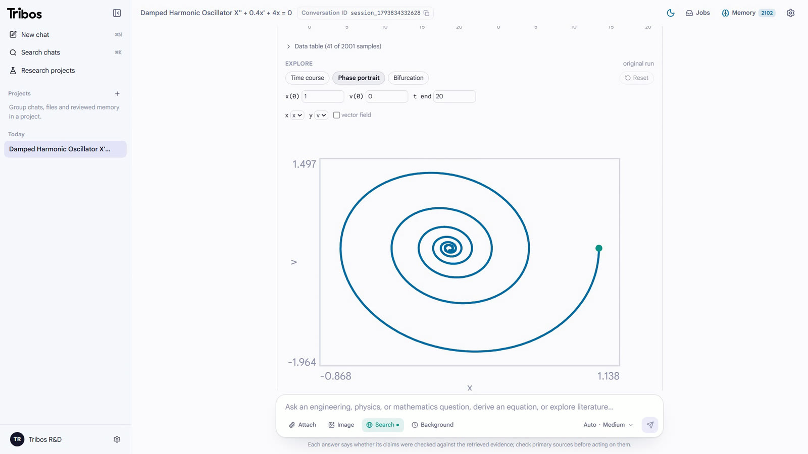
</td>
</tr>
</table>

<p align="center">
  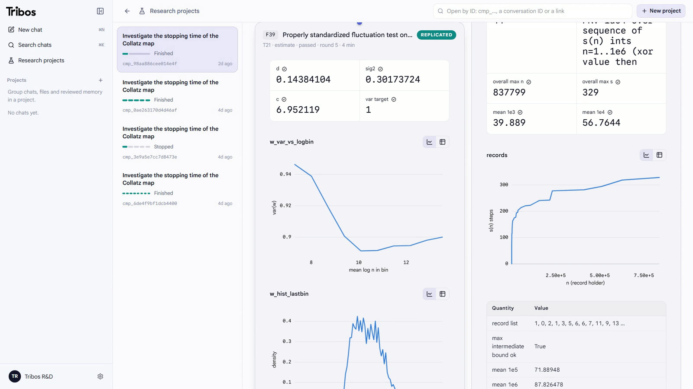
  <br>
  <sub>The findings wall: each result with its checked numbers, charts and verification seal.</sub>
</p>

## Built on Meta Muse Spark

Tribos runs on **`muse-spark-1.3`** through the **Meta Model API** (`https://api.meta.ai/v1`). It is the default
model for every role, and with the default settings only Meta models are offered. The model does the
reasoning; deterministic tools do the arithmetic, and independent checkers decide what counts as verified.

| Role | What Muse Spark does |
| :--- | :--- |
| **Routing and planning** | Reads the question, picks the architecture, and plans a graph of tool calls that run concurrently. |
| **Specialist agents** | Drives the five domain agents and the supervisor, swarm and debate frameworks through tool calls. |
| **Mathematics agent** | Takes over when the deterministic strategy ladder finds no checked answer, and repairs failed steps. |
| **Vision** | Two separate readings of a photographed problem, then review and repair when they disagree. |
| **Formal proofs** | Formalises statements in Lean 4 and repairs them from the compiler's errors. |
| **Research loop** | Writes the charter, analyses each round, judges the evidence and writes the thesis chapter by chapter. |
| **Writing** | Turns checked results into a derivation-first answer, then a copy edit that may not add numbers. |

Tribos maps its effort levels (from *minimal* to *ultra*) onto Muse Spark's `reasoning_effort`, so quick lookups stay
fast and research work gets deep reasoning.

## How it works

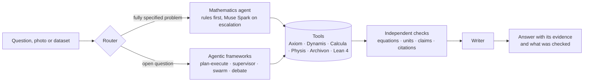

| Engine | What it does | Built on |
| :--- | :--- | :--- |
| **Axiom** | Exact symbolic mathematics: solving, calculus, ODEs, linear algebra, number theory, identities | SymPy, mpmath |
| **Dynamis** | Simulation and analysis: ODE/IVP, PDEs, stability, continuation, fitting, optimisation | SciPy |
| **Calcula** | Sandboxed Python and dataset profiling (CSV, TSV, HDF5, MAT, Parquet, XLSX) | NumPy, Pandas, Matplotlib |
| **Physis** | CODATA 2022 constants, units and dimensional checks, materials data, engineering calculators | Pint, NIST CODATA |
| **Archivon** | Literature search and citation grounding, papers read and reproduced | arXiv, zbMATH, Crossref, OpenAlex, Semantic Scholar, NASA ADS |
| **Formal** | Proof formalisation and checking with an axiom audit | Lean 4 |

The research loop on top of these engines:

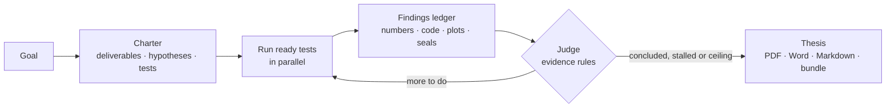

**Honest by design.** The mathematics agent reports `verified`, `partially_verified`, `unverified` or `failed`, with
the checks that passed and the gaps that remain. Its verifier re-derives every check from the *original* question,
never from the agent's own arguments. Citations are grounded against the retrieved sources, and an answer with nothing
checkable says so instead of claiming confidence.

## Quick start

**You need:** Python 3.12+, [uv](https://docs.astral.sh/uv/), Node.js 22+, and a Meta Model API key. Optional: Lean 4
(formal proofs), Tesseract (image reading), Docker.

```sh
# 1. Get the code and the Python dependencies
git clone https://github.com/AtlasRoX/TribosAI.git && cd TribosAI
uv sync --extra dev --frozen

# 2. Configure: set META_API_KEY in .env (TRIBOS_AUTH_MODE=disabled for local development)
cp .env.example .env

# 3. Start the API on http://127.0.0.1:8000
uv run uvicorn app.backend.main:app --host 127.0.0.1 --port 8000

# 4. In a second terminal, start the web app on http://localhost:3000
cd web && npm ci && npm run dev
```

Or run both with Docker:

```sh
docker compose -f docker/compose.yml up --build
```

Every setting is documented in [docs/configuration.md](docs/configuration.md), and [`.env.example`](.env.example) is a
commented template.

## More to explore

- **Six orchestration modes**: Auto routing, Plan-and-Execute, ReAct compiler, supervisor, specialist swarm and
  multi-agent debate, selectable per request.
- **Uploaded papers**: equations, parameters and stated results are extracted with page references, then reproduced.
- **Projects**: shared chats and files, project instructions and reviewed memory, with owner, editor and viewer roles.
- **Exports for every answer**: Markdown, Word with native equations, PDF, and a Jupyter notebook that re-runs the
  computations and asserts their values.
- **Open interfaces**: a Model Context Protocol server (`POST /mcp`) and an Agent-to-Agent card
  (`/.well-known/agent-card.json`).
- **Background jobs** with reconnectable streams, steering while a run is in progress, and plan approval.

## Repository layout

| Path | Contents |
| :--- | :--- |
| [`app/backend/`](app/backend) | FastAPI app, routers, auth and per-user limits |
| [`tribos/agentic/`](tribos/agentic) | Router, frameworks, sandbox, formal proofs and the research loop (`research/`) |
| [`tribos/axiom/`](tribos/axiom) · [`dynamis/`](tribos/dynamis) · [`physis/`](tribos/physis) · [`archivon/`](tribos/archivon) | The specialist engines |
| [`tribos/vision/`](tribos/vision) | Image reading: OCR, vision readings, consensus and repair |
| [`tribos/verify/`](tribos/verify) | Claim, equation, unit and citation checks; the Lean runner |
| [`tribos/writer/`](tribos/writer) · [`tribos/export/`](tribos/export) | Answer writing; PDF, Word, notebook and thesis exports |
| [`web/`](web) | Next.js 16 and React 19 app with KaTeX |
| [`tests/`](tests) · [`docs/`](docs) | Test suite and documentation |

## Quality

- **2,000+ automated tests**, run offline with fakes (no network, no model calls): `uv run pytest -q`.
- Blocking CI gates: `ruff`, `bandit`, `mypy` on the typed core, generated-config drift check, and for the web app
  `typecheck`, `eslint`, unit tests and a production build.
- A hardened sandbox: banned modules, no subprocesses, filesystem guards and resource limits. Untrusted maths is only
  ever parsed with a safe expression parser, never `eval`.

## Documentation

| Topic | Where |
| :--- | :--- |
| The research loop: charter, tiers, judge, stopping rules, thesis | [docs/agentic/research-loop.md](docs/agentic/research-loop.md) |
| Image reading: OCR, vision readings and consensus | [docs/agentic/image-reading.md](docs/agentic/image-reading.md) |
| Scientific validation and architecture | [docs/SCIENTIFIC_VALIDATION_AND_ARCHITECTURE.md](docs/SCIENTIFIC_VALIDATION_AND_ARCHITECTURE.md) |
| Developer guide | [docs/developer/README.md](docs/developer/README.md) · [AGENTS.md](AGENTS.md) |
| Configuration reference | [docs/configuration.md](docs/configuration.md) |
| Roadmap | [docs/FEATURE_ROADMAP.md](docs/FEATURE_ROADMAP.md) |
| Contributing | [docs/CONTRIBUTING.md](docs/CONTRIBUTING.md) |

## Credits

Made by **ChronoStrider Engineering**. Built on Meta Muse Spark for the Meta AI Global Hackathon 2026.

Tribos stands on SymPy, SciPy, mpmath, Pint, Lean 4, Tesseract, KaTeX, FastAPI and Next.js. Demo video: music by
Sascha Ende ([ende.app](https://ende.app), CC BY 4.0); voiceover by [ElevenLabs](https://elevenlabs.io).
