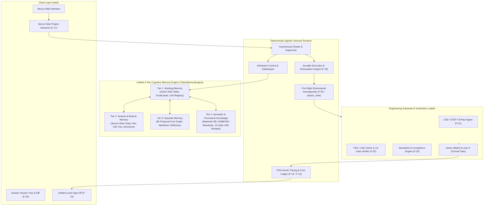
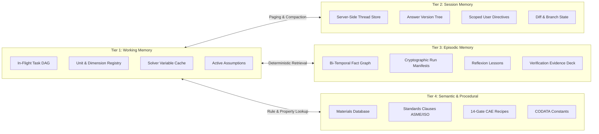
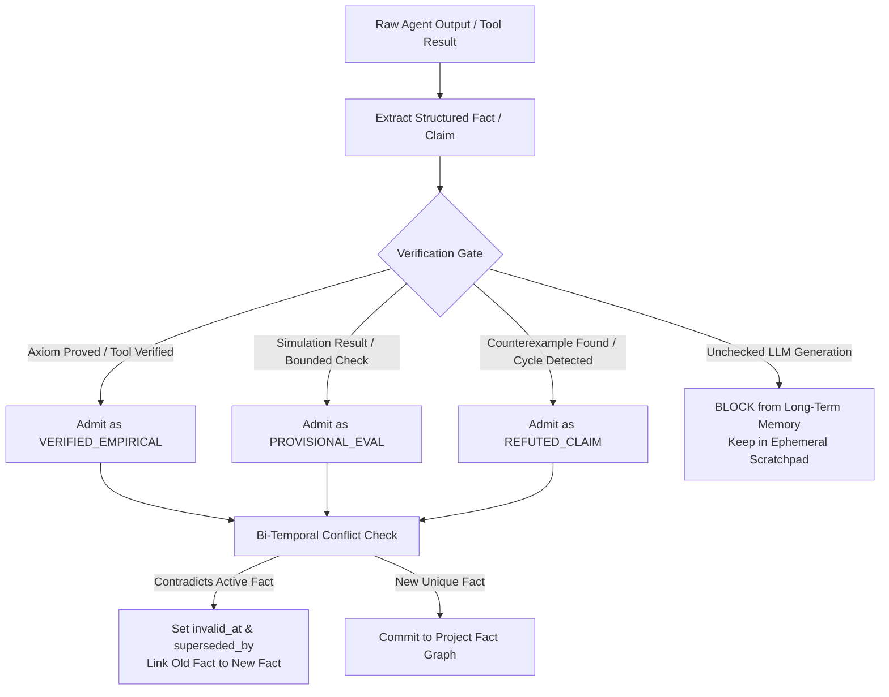
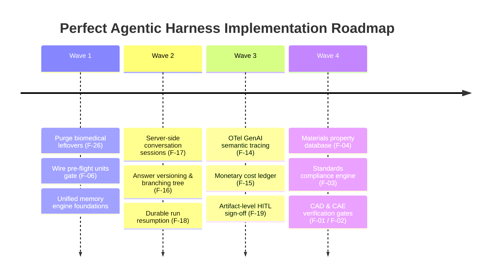

# Tribos Perfect Agentic Harness & Cognitive Memory Architecture

> **Document Type:** System Architecture Specification & Implementation Blueprint  
> **Target:** `X:\tribois` (Tribos Engineering R&D Agentic Harness)  
> **Scope:** Closes all memory and harness gaps from [`AGENTIC_ENGINEERING_HARNESS_GAP_ANALYSIS.md`](file:///X:/tribois/docs/AGENTIC_ENGINEERING_HARNESS_GAP_ANALYSIS.md) (P0 through P3, Tier 0 through Tier 3) using state-of-the-art 2026 agentic engineering patterns.

---

## Executive Summary: "The Model Is a Function; the Harness Is the Product"

Modern agentic engineering systems have revealed a clear consensus: **frontier LLMs are stateless reasoning engines; the harness runtime and memory layer govern whether an agent succeeds over long-horizon, high-stakes tasks.**

Naive vector similarity searches over raw chat logs fail in physical engineering R&D due to:
1. **The "Funes" Context Bloat Problem:** Unstructured vector dumps pollute the context window, causing prompt degradation and "lost in the middle" errors.
2. **Context Rot & Compaction Loss:** Multi-round summarization destroys unit definitions, tolerance bounds, and safety constraints within 2–3 compaction cycles.
3. **Model Initiation Blindness:** Models rarely invoke memory retrieval tools proactively unless deterministically cued by the runtime.
4. **State Amnesia & Poisoning:** Storing mutable design variables without bi-temporal stamps surfaces stale, contradictory specifications (e.g., retrieving Rev A dimensions during Rev C stress analysis).

To transform Tribos into a world-class agentic engineering harness, this blueprint establishes:
- A **Unified 4-Tier Cognitive Memory System** (CoALA + Letta + Zep/Graphiti + Mem0 + HippoRAG).
- A **Durable, Resumable Execution Harness** with OpenTelemetry GenAI tracing, monetary ledgers, and artifact-level HITL sign-off.
- A **Domain-Native Engineering Substrate** with pre-flight dimensional gating, 14-gate CAE verification, and machine-checkable standards compliance.



---

## 1. Unified 4-Tier Cognitive Memory Architecture

Tribos currently suffers from a fragmented memory architecture: `research_memory.py` handles turn instructions and BM25 search (with legacy biomedical regexes), while `project_store.py` handles a separate bi-temporal fact graph. Meanwhile, chat conversations live only in browser `localStorage`.

The new **`TribosMemoryEngine`** consolidates this into four cleanly separated cognitive tiers.



### Tier 1: Working Memory (Runtime State & Context Window Management)
- **Role:** Immediate execution scratchpad for active phases, sub-questions, and multi-agent handoffs.
- **Components:**
  1. **Active Task DAG & Goal Ledger:** Tracks open, answered, and failed sub-questions with dependencies.
  2. **Unit System Registry:** Binds every physical quantity to its SI/Imperial dimension and checks consistency before tool dispatch.
  3. **Specialist Scratchpad:** Inter-agent shared cache where numeric results (e.g. eigenvalue $\omega_n$, reaction force $F_R$) are immediately available to sibling specialists without context bloat.
  4. **Paging Controller:** Dynamically injects only relevant facts into the prompt window based on current task cues, keeping token overhead sublinear.

### Tier 2: Short-Term Session Memory & Design Branching (F-16, F-17)
- **Role:** Replaces browser `localStorage` with a persistent, server-side project conversation and design-tree store.
- **Components:**
  1. **Server-Side Project Sessions (`F-17`):** Stores conversation turns, agent thoughts, and user interventions in PostgreSQL / SQLite, enabling multi-user collaboration and cross-device access.
  2. **Answer Versioning Tree (`F-16`):** Rather than overwriting answers, each synthesis produces an immutable revision (`rev_1`, `rev_2`) with parent pointers. Engineers can branch design paths (e.g., "Branch A: Aluminum 6061-T6" vs. "Branch B: Titanium Ti-6Al-4V") and generate visual AST diffs.
  3. **Scoped User Directives:** Directives categorized by validity: `current_turn` (single query), `session` (this investigation), or `project_profile` (global project constraint).

### Tier 3: Long-Term Episodic Memory (Bi-Temporal Graph & Reflexion)
- **Role:** The historical record of physical findings, verified evidence, and operational lessons.
- **Components:**
  1. **Bi-Temporal Fact Graph (`valid_from`, `invalid_at`, `recorded_at`):**
     Facts carry twin time-axes based on Zep/Graphiti. When a parameter changes (e.g., bracket load increases from 500 N to 750 N), the old fact is superseded (`superseded_by`), preserving the historical trajectory of design modifications.
  2. **Cryptographic Provenance Binding:**
     Every admitted memory node is linked to a Run Manifest ID (`mnf_<hash>`) containing tool inputs, outputs, git commit, and verifier verdicts. Prevents cross-session hallucination or prompt injection.
  3. **Reflexion & Failure Lessons:**
     When a solver diverges, a mesh fails aspect-ratio checks, or an Axiom claim is disproved, the failure mode is extracted into a `ReflexionLesson`. Future runs cue these lessons during plan generation to prevent duplicate mistakes.
  4. **Retrieval via HippoRAG & Personalized PageRank:**
     Entity-seeded Personalized PageRank over the fact graph guarantees multi-hop relational discovery without vector semantic drift.

### Tier 4: Semantic & Procedural Knowledge (Engineering Substrate)
- **Role:** Foundational physical laws, materials, engineering standards, and verified solver recipes.
- **Components:**
  1. **Materials & Property Service (`F-04`):**
     Temperature-dependent elastic modulus $E(T)$, Poisson's ratio $\nu(T)$, thermal expansion $\alpha(T)$, yield strength, and Wöhler S-N fatigue curves. Backed by CODATA fundamental physical constants.
  2. **Machine-Checkable Standards Library (`F-03`):**
     Atomic clause rules for ASME VIII Div 1 (pressure vessels), API 620/650, ISO 9001, and Eurocodes. Each clause is structured as `(predicate, required_inputs, tolerance, citation)`.
  3. **14-Stage CAE Verification Ladder (`F-02`):**
     Procedural knowledge executing the canonical FEA verification pipeline (CAD cleanup $\to$ mesh $\to$ material $\to$ BCs $\to$ solve $\to$ reaction balance $\to$ mesh convergence $\to$ singularity screen $\to$ linear-elastic validity $\to$ hand-calc cross-check $\to$ sign-off).

---

## 2. Memory Admission Control & Write-Time Governance



### Strict Admission Rules:
1. **Never Promote Unverified Prose:** Raw LLM-generated assertions are forbidden from entering long-term semantic memory. Only claims backed by Axiom symbolic proofs, SymPy verified arithmetic, sandboxed execution, or Lean 4 formal correspondence receive `VERIFIED_EMPIRICAL` status.
2. **Explicit Supersession:** If an agent discovers that a previously accepted formula or geometry parameter is invalid (e.g. wall thickness was updated), the old memory node is stamped with `invalid_at = now()` and pointed to the replacement.
3. **Purge Biomedical Leftovers (`F-26`):** Remove all legacy cancer/genetics regexes (`KNOWN_TARGET_PATTERN`, `KNOWN_BIOMODEL_PATTERN`) from `research_memory.py`, replacing them with STEM-native entity extractors: `materials`, `dimensions`, `loads`, `standards`, `governing_equations`, `boundary_conditions`.

---

## 3. The Perfect Agentic Harness Architecture

The harness runtime wraps the execution loop with deterministic guarantees, observability, and durable lifecycle management.

### A. First-Class Run Resumption & Durable Execution (`F-18`)
- **Problem in current codebase:** An interrupted or failed run must be restarted from the beginning or replayed from scratch via provenance.
- **SOTA Solution:**
  - Implement a **Checkpoint-at-Phase** durable state machine.
  - Every agent step logs its input, tool dispatch, output, and working memory delta to an append-only event log.
  - Expose a `POST /api/runs/{run_id}/resume` endpoint: if a long-running FEA mesh or formal proof run is severed by network timeout or node restart, the harness hydrates `AgentState` from the last valid checkpoint and resumes without re-executing expensive completed steps.

### B. Pre-Flight Dimensional Homogeneity Gate (`F-06` / `physis_units`)
- **Problem in current codebase:** Units are only audited on the final written answer; `physis_units` is disconnected, allowing dimensionally broken equations to execute.
- **SOTA Solution:**
  - Intercept every tool dispatch in `AgentState.call_tool`.
  - Perform pre-flight dimensional analysis using SymPy's physics units module or Pint.
  - Example: If a tool receives `load = 500 N` and `pressure = 200 MPa` to compute area, the harness verifies $[F] / [P] = [L]^2$ before invoking the solver. If units conflict, the call is rejected fail-closed with a typed `DimensionalMismatchError`.

### C. OpenTelemetry GenAI Semantic Tracing (`F-14`)
- **Problem in current codebase:** Custom tool trace format that cannot be ingested by standard APM tools (Datadog, MLflow, Laminar).
- **SOTA Solution:**
  - Wrap agent execution in standard OpenTelemetry spans:
    - Root Span: `agent.workflow` (attributes: `framework`, `project_id`, `effort_level`).
    - Child Spans: `gen_ai.client` (LLM calls), `agent.tool.execute` (tool name, tool version, duration), `agent.memory.query` (retrieval technique, recall@k, latency), `agent.verification` (checker name, verdict).
  - Include token counts, model IDs, and git commit hashes on every span.

### D. Monetary Cost Ledger (`F-15`)
- Track exact token expenditures per model (prompt, completion, cached tokens) and map to real-time currency pricing.
- Enforce hard budget caps per project/run, with automated alerts and graceful degradation to cheaper verification models when approaching limits.

### E. Artifact-Level Human-in-the-Loop (HITL) Sign-Off (`F-19`)
- Move beyond binary plan approval.
- Allow certified engineers to inspect specific artifacts (e.g., an ASME wall thickness calculation, a 3D stress concentration contour, or a Lean correspondence statement).
- Engineers can attach a cryptographic digital sign-off, annotate corrections, or request targeted rework on an isolated phase without resetting the entire project run.

---

## 4. Architectural Implementation Blueprint

### File Structure & Module Organization

```
tribos/
├── memory/                       # UNIFIED COGNITIVE MEMORY ENGINE
│   ├── __init__.py               # Exports TribosMemoryEngine
│   ├── engine.py                 # Core unified memory coordinator
│   ├── working.py                # Tier 1: In-flight DAG, scratchpad, unit registry
│   ├── session.py                # Tier 2: Server-side sessions, answer version tree (F-16/F-17)
│   ├── episodic.py               # Tier 3: Bi-temporal fact graph, manifests, reflexion
│   ├── semantic.py               # Tier 4: Materials DB, standards clauses, physical constants
│   ├── admission.py              # Admission control, fact verification gating
│   └── retrieval.py              # HippoRAG PPR + BM25 + dense hybrid retrieval
│
├── harness/                      # AGENTIC HARNESS RUNTIME
│   ├── __init__.py
│   ├── durable.py                # Run checkpointing & resumption state machine (F-18)
│   ├── preflight.py              # Pre-flight dimensional homogeneity gate (F-06)
│   ├── tracing.py                # OpenTelemetry GenAI semantic conventions (F-14)
│   ├── cost_ledger.py            # Token-to-currency ledger & spend manager (F-15)
│   └── hitl.py                   # Artifact-level engineer sign-off & annotation (F-19)
│
├── substrate/                    # PHYSICAL & INDUSTRIAL ENGINEERING SUBSTRATE
│   ├── cad/                      # STEP/IGES ingest & geometry inspection (F-01)
│   ├── fea/                      # Mesh, solvers & 14-gate CAE review (F-02)
│   ├── standards/                # ASME/ISO/API compliance rule engine (F-03)
│   └── materials/                # Temp-dependent & S-N curve database (F-04)
```

---

## 5. Phased Implementation Roadmap



### Action Items & Deliverables

1. **Sprint 1 (Memory Engine Consolidation & Hygiene):**
   - Create `tribos/memory/engine.py` unifying `project_store.py` and `research_memory.py`.
   - Strip biomedical regexes (`KNOWN_TARGET_PATTERN`) and clinical verifier remnants, replacing with STEM entity recognition.
   - Wire `physis_units` into `preflight.py` for fail-closed dimensional verification before solver execution.

2. **Sprint 2 (Session Persistence & Resumption):**
   - Implement `session.py` to migrate chat history from browser `localStorage` to server-backed storage (`F-17`).
   - Implement immutable answer versioning (`F-16`) with visual diff capabilities in the frontend.
   - Build `durable.py` supporting `resume_run(run_id, from_phase)` with checkpoint restoration (`F-18`).

3. **Sprint 3 (Harness Observability & Governance):**
   - Instrument `tracing.py` emitting standard OTel GenAI spans.
   - Integrate `cost_ledger.py` calculating run spend against user/project allocations.
   - Implement `hitl.py` adding `approve_artifact` and `annotate_claim` actions to `RunControl`.

4. **Sprint 4 (Engineering Substrate Integration):**
   - Connect materials property database (`F-04`) to the semantic memory tier.
   - Integrate ASME VIII-1 and ISO compliance clauses (`F-03`) as machine-checkable rules.
   - Implement the 14-gate CAE verification workflow (`F-02`).
