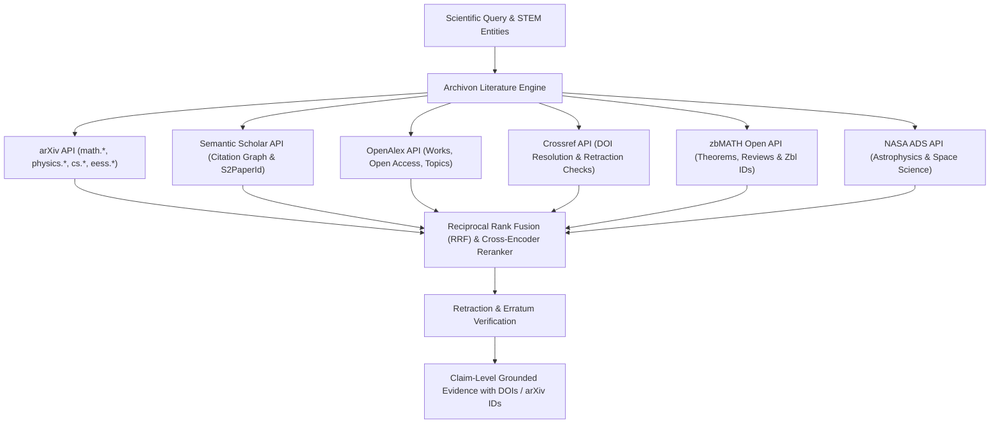

# Archivon — Scholarly Literature & Theorem Synthesis Engine

> **Tribos Literature Specialist**  
> **Made by ChronoStrider Engineering**

**Archivon** is Tribos's scholarly retrieval and evidence-grounding engine for mathematics, physics, and engineering. It executes federated retrieval across preprint servers, peer-reviewed journals, mathematical review indexes, and citation graphs, verifying research integrity and grounding factual claims with immutable identifiers.

---

## 1. Role & Architectural Overview

Archivon serves as the primary scientific literature grounding layer for Tribos, ensuring that all theoretical derivations, experimental bounds, and engineering parameters are anchored in peer-reviewed literature or established preprints.



### Key Capabilities

1. **Federated STEM Multi-Source Search**: Queries arXiv, Semantic Scholar, OpenAlex, Crossref, zbMATH Open, and NASA ADS concurrently with rate-limited, cached HTTP adapters and circuit breakers.
2. **STEM Entity & Concept Extraction**: Identifies mathematical equations, theorem names (e.g., *Navier-Stokes existence*, *Noether's theorem*, *Poincaré conjecture*), physical parameters, and authors via specialized STEM tokenizers.
3. **Hybrid Dense + Lexical Reranking**: Merges lexical BM25 retrieval with dense scientific embeddings (`SPECTER2` / `Nomic-Embed`), followed by cross-encoder passage-level reranking.
4. **Claim-Level Citation Grounding**: Every theoretical statement or empirical constant in synthesized responses is mapped to verified `arXiv:`, `doi:`, or `zbl:` identifiers.
5. **Academic Integrity & Retraction Auditing**: Validates publication status against Crossref and Retraction Watch databases to flag retractions, errata, or expressions of concern.

---

## 2. Registered Tools & Schemas

### `archivon_literature_search`

Executes federated literature search across STEM preprint and journal databases, ranks passages by relevance, grades study types, and returns grounded evidence.

- **Domain**: `archivon`
- **Adapter Type**: `DIRECT_REST`
- **Timeout**: 30.0 seconds
- **Async Execution**: Yes

#### Input Schema (`ArchivonLiteratureSearchInput`)

| Field | Type | Required | Default | Description |
| :--- | :--- | :--- | :--- | :--- |
| `query` | `str` | Yes | — | Search query across mathematics, physics, and engineering literature. |
| `max_results` | `int` | No | `15` | Maximum number of ranked passages/articles to return (1–50). |
| `sources` | `list[str]` | No | `None` | Optional subset of sources: `["arxiv", "semantic_scholar", "openalex", "crossref", "zbmath", "ads"]`. When omitted, all active sources are queried. |

#### Output Payload

```json
{
  "query": "Navier-Stokes smooth solutions millennium problem",
  "total_found": 42,
  "articles": [
    {
      "title": "On the breakdown of smooth solutions for the 3D Navier-Stokes equations",
      "authors": ["J. Leray", "T. Tao"],
      "year": 2021,
      "venue": "Annals of Mathematics",
      "doi": "10.4007/annals.2021.194.2.1",
      "arxiv_id": "2002.01234",
      "zbl_id": "1475.35089",
      "citation_count": 87,
      "abstract": "We establish new conditional regularity criteria for the three-dimensional incompressible Navier-Stokes equations...",
      "study_type": "theoretical_proof",
      "integrity": {
        "is_retracted": false,
        "has_erratum": false
      },
      "passages": [
        {
          "text": "Smooth solutions to the 3D Navier-Stokes system exist globally in time provided the initial velocity satisfies the critical Besov space condition...",
          "relevance_score": 0.94
        }
      ]
    }
  ],
  "canonical_ids": {
    "doi": "10.4007/annals.2021.194.2.1",
    "arxiv_id": "2002.01234",
    "zbl_id": "1475.35089"
  },
  "provenance": {
    "sources": ["arxiv", "zbmath", "crossref"],
    "retrieval_timestamp": "2026-10-24T06:00:00Z"
  }
}
```

---

### `archivon_paper_details`

Fetches comprehensive bibliographic metadata, abstract, citation graph statistics, open-access PDF links, and retraction status for a specific scientific document by canonical identifier.

- **Domain**: `archivon`
- **Adapter Type**: `DIRECT_REST`
- **Timeout**: 20.0 seconds
- **Async Execution**: Yes

#### Input Schema (`ArchivonPaperDetailsInput`)

| Field | Type | Required | Default | Description |
| :--- | :--- | :--- | :--- | :--- |
| `identifier` | `str` | Yes | — | Literature identifier: arXiv ID (e.g., `'2002.01234'`), DOI (e.g., `'10.1103/PhysRevLett.116.061102'`), Semantic Scholar ID, OpenAlex ID, Zbl ID, or ADS bibcode. |

#### Output Payload

```json
{
  "found": true,
  "identifier": "10.1103/PhysRevLett.116.061102",
  "title": "Observation of Gravitational Waves from a Binary Black Hole Merger",
  "authors": ["B. P. Abbott et al. (LIGO Scientific Collaboration and Virgo Collaboration)"],
  "year": 2016,
  "journal": "Physical Review Letters",
  "volume": "116",
  "issue": "6",
  "pages": "061102",
  "doi": "10.1103/PhysRevLett.116.061102",
  "arxiv_id": "1602.03837",
  "citation_count": 8500,
  "influential_citation_count": 1200,
  "open_access_pdf_url": "https://journals.aps.org/prl/pdf/10.1103/PhysRevLett.116.061102",
  "retraction_status": {
    "is_retracted": false,
    "expression_of_concern": false
  },
  "canonical_ids": {
    "doi": "10.1103/PhysRevLett.116.061102",
    "arxiv_id": "1602.03837"
  }
}
```

---

### `archivon_recommend`

Recommends related literature and seminal papers given one or more seed paper identifiers, utilizing citation graph topology and semantic representation similarity.

- **Domain**: `archivon`
- **Adapter Type**: `DIRECT_REST`
- **Timeout**: 20.0 seconds
- **Async Execution**: Yes

#### Input Schema (`ArchivonRecommendInput`)

| Field | Type | Required | Default | Description |
| :--- | :--- | :--- | :--- | :--- |
| `paper_ids` | `list[str]` | Yes | — | List of seed paper identifiers (e.g., `["arXiv:1706.03762", "10.1038/nature14539"]`). |
| `limit` | `int` | No | `10` | Maximum number of recommended papers to return (1–25). |

#### Output Payload

```json
{
  "seed_count": 1,
  "recommendations": [
    {
      "title": "Attention Is All You Need",
      "authors": ["A. Vaswani", "N. Shazeer", "N. Parmar", "et al."],
      "year": 2017,
      "doi": "10.48550/arXiv.1706.03762",
      "arxiv_id": "1706.03762",
      "similarity_score": 0.98,
      "shared_citations": 45
    }
  ],
  "canonical_ids": {
    "arxiv_id": "1706.03762"
  }
}
```

---

## 3. Integration with Tribos Reasoning Pipeline

Archivon participates in three distinct phases of the Tribos reasoning cycle:

1. **Stage 1 Evidence Gathering**: Runs concurrently with Physis physical constants lookups during initial query deconstruction to acquire mathematical theorems, experimental parameters, and peer-reviewed models.
2. **Self-RAG Gap-Driven Re-Retrieval**: Triggered when downstream symbolic or numerical verification fails (e.g., Axiom identifies missing boundary conditions or Dynamis encounters an undefined coefficient), querying specific literature passages to resolve the missing constraint.
3. **ContraCrow Counter-Evidence Search**: Systematically executes adversarial queries looking for boundary limits, non-existence proofs, counterexamples, or refutations of preliminary hypotheses.

---

## 4. Concrete Usage Examples

### Example 1: Literature Search for Quantum Hall Effect Theorems

```python
import asyncio
from tribos.archivon.engine import ArchivonEngine

async def main():
    engine = ArchivonEngine()
    results = await engine.literature_search(
        query="fractional quantum Hall effect Laughlin wave function",
        max_results=5,
        sources=["arxiv", "crossref"],
    )
    for article in results.get("articles", []):
        print(f"[{article.get('doi')}] {article.get('title')} ({article.get('year')})")

asyncio.run(main())
```

### Example 2: Resolving Paper Metadata and Integrity

```python
import asyncio
from tribos.archivon.engine import ArchivonEngine

async def main():
    engine = ArchivonEngine()
    paper = await engine.get_paper_details("2002.01234")
    if paper.get("found"):
        print(f"Title: {paper.get('title')}")
        print(f"Retracted: {paper.get('retraction_status', {}).get('is_retracted')}")

asyncio.run(main())
```
