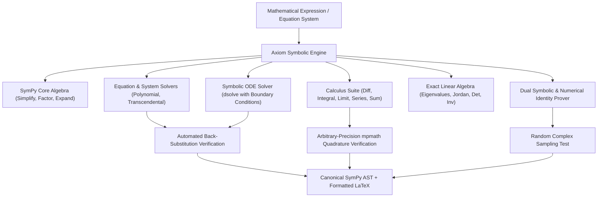

# Axiom — Symbolic Mathematics, Computer Algebra & Formal Verification Engine

> **Tribos Symbolic Specialist**  
> **Made by ChronoStrider Engineering**

**Axiom** is Tribos's exact computer algebra and formal verification engine. Powered by SymPy, mpmath arbitrary-precision arithmetic, and rigorous back-substitution solvers, Axiom computes closed-form solutions, evaluates calculus operations, performs symbolic linear algebra, verifies mathematical identities, and formats equations into canonical LaTeX.

---

## 1. Role & Architectural Overview

Axiom provides infallible mathematical precision to Tribos, eliminating algebraic errors, hallucinated roots, and invalid analytical steps in scientific derivations.



### Key Capabilities

1. **Exact Symbolic Computer Algebra**: Computes exact rational, radical, and transcendental simplifications without floating-point truncation or round-off error.
2. **Analytical Equation & System Solving**: Solves linear, polynomial, and nonlinear systems over complex ($\mathbb{C}$) or real ($\mathbb{R}$) domains, with automatic verification by back-substituting solutions into original equations.
3. **Analytical Calculus & Differential Equations**: Evaluates derivatives, definite/indefinite integrals, limits, Taylor/Laurent series expansions, and closed-form ODE solutions with initial/boundary conditions.
4. **Exact Linear Algebra & Spectral Analysis**: Computes exact matrix determinants, inverses, eigenvalues with algebraic/geometric multiplicities, eigenvectors, and Jordan canonical forms.
5. **Dual-Tier Identity Verification**: Proves or refutes equivalence $LHS \equiv RHS$ by checking if $\text{simplify}(LHS - RHS) = 0$ symbolically and sampling random test points in $\mathbb{C}$ at high numerical precision via `mpmath`.
6. **Canonical LaTeX Generation**: Parses raw mathematical strings and outputs standardized LaTeX representations for frontend KaTeX rendering.

---

## 2. Registered Tools & Schemas

### `axiom_simplify`

Simplifies, factors, expands, and rewrites mathematical expressions into canonical symbolic forms.

- **Domain**: `axiom`
- **Adapter Type**: `LOCAL_COMPUTE`
- **Timeout**: 30.0 seconds

#### Input Schema (`AxiomSimplifyInput`)

| Field | Type | Required | Default | Description |
| :--- | :--- | :--- | :--- | :--- |
| `expression` | `str` | Yes | — | Mathematical expression to simplify (e.g., `"(x^2 - 1)/(x - 1)"`, `"sin(x)^2 + cos(x)^2"`). |
| `assumptions` | `dict[str, str]` | No | `None` | Optional symbol assumptions mapping variable names to properties (e.g., `{"x": "positive, real"}`). |

#### Output Payload

```json
{
  "expression": "(x^2 - 1)/(x - 1)",
  "simplified": "x + 1",
  "canonical_expr": "x + 1",
  "latex": "x + 1",
  "canonical_id": "comp:axiom_simplify:a4f912e",
  "verified": true
}
```

---

### `axiom_solve`

Solves algebraic or transcendental equations and systems symbolically, checking all solutions via back-substitution.

- **Domain**: `axiom`
- **Adapter Type**: `LOCAL_COMPUTE`
- **Timeout**: 30.0 seconds

#### Input Schema (`AxiomSolveInput`)

| Field | Type | Required | Default | Description |
| :--- | :--- | :--- | :--- | :--- |
| `equations` | `str \| list[str]` | Yes | — | Single equation string (e.g. `'x^2 - 4 = 0'`) or list of equation strings for a coupled system. |
| `variables` | `str \| list[str]` | No | `None` | Variable(s) to solve for; inferred from free symbols when omitted. |
| `domain` | `str` | No | `'complex'` | Solution domain: `'complex'` or `'real'`. |

#### Output Payload

```json
{
  "equations": ["x^2 - 5*x + 6 = 0"],
  "variables": ["x"],
  "solutions": [
    {"x": 2},
    {"x": 3}
  ],
  "latex": ["x = 2", "x = 3"],
  "verified": true,
  "canonical_id": "comp:axiom_solve:8e29bc1"
}
```

---

### `axiom_calculus`

Performs symbolic differentiation, integration (with mpmath numeric cross-check), limits, Taylor series expansions, and summations.

- **Domain**: `axiom`
- **Adapter Type**: `LOCAL_COMPUTE`
- **Timeout**: 30.0 seconds

#### Input Schema (`AxiomCalculusInput`)

| Field | Type | Required | Default | Description |
| :--- | :--- | :--- | :--- | :--- |
| `expression` | `str` | Yes | — | Mathematical expression to operate on. |
| `operation` | `str` | Yes | — | Calculus operation: `'diff'`, `'integrate'`, `'limit'`, `'series'`, or `'sum'`. |
| `variable` | `str` | No | `'x'` | Independent variable of operation. |
| `order` | `int` | No | `1` | Derivative order or series expansion truncation order. |
| `lower` | `str` | No | `None` | Lower bound for definite integration or summation. |
| `upper` | `str` | No | `None` | Upper bound for definite integration or summation. |
| `point` | `str` | No | `None` | Evaluation point for limit or series expansion (e.g., `'0'`, `'oo'`). |

#### Output Payload

```json
{
  "expression": "exp(-x^2)",
  "operation": "integrate",
  "variable": "x",
  "lower": "-oo",
  "upper": "oo",
  "result": "sqrt(pi)",
  "latex": "\\sqrt{\\pi}",
  "numerical_value": 1.772453850905516,
  "verified": true,
  "canonical_id": "comp:axiom_calculus:c19a84d"
}
```

---

### `axiom_dsolve`

Solves ordinary differential equations (ODEs) analytically with optional initial and boundary conditions.

- **Domain**: `axiom`
- **Adapter Type**: `LOCAL_COMPUTE`
- **Timeout**: 30.0 seconds

#### Input Schema (`AxiomDsolveInput`)

| Field | Type | Required | Default | Description |
| :--- | :--- | :--- | :--- | :--- |
| `equation` | `str` | Yes | — | Ordinary differential equation (e.g., `"y''(x) + omega^2 * y(x) = 0"`). |
| `func` | `str` | No | `'y(x)'` | Dependent function with independent variable. |
| `ics` | `dict` | No | `None` | Initial/boundary conditions (e.g., `{"y(0)": 1, "y'(0)": 0}`). |

#### Output Payload

```json
{
  "equation": "y''(x) + 4*y(x) = 0",
  "func": "y(x)",
  "ics": {"y(0)": 1, "y'(0)": 0},
  "solution": "cos(2*x)",
  "latex": "y{\\left(x \\right)} = \\cos{\\left(2 x \\right)}",
  "verified": true,
  "canonical_id": "comp:axiom_dsolve:d4b1239"
}
```

---

### `axiom_linalg`

Executes exact linear algebra: eigenvalues/eigenvectors, determinants, inverses, rank, RREF, SVD, and nullspaces.

- **Domain**: `axiom`
- **Adapter Type**: `LOCAL_COMPUTE`
- **Timeout**: 30.0 seconds

#### Input Schema (`AxiomLinalgInput`)

| Field | Type | Required | Default | Description |
| :--- | :--- | :--- | :--- | :--- |
| `matrix` | `list[list]` | Yes | — | 2D matrix of numbers or symbolic expressions (e.g. `[[1, 2], [2, 1]]`). |
| `operation` | `str` | Yes | — | Linear algebra operation: `'eigen'`, `'det'`, `'inv'`, `'rref'`, `'svd'`, `'nullspace'`, `'charpoly'`, `'solve'`. |
| `rhs` | `list` | No | `None` | Right-hand side vector for `operation='solve'` ($M x = b$). |

#### Output Payload

```json
{
  "matrix": [[1, 2], [2, 1]],
  "operation": "eigen",
  "eigenvalues": [
    {"value": -1, "multiplicity": 1},
    {"value": 3, "multiplicity": 1}
  ],
  "eigenvectors": [
    {"eigenvalue": -1, "vector": [-1, 1]},
    {"eigenvalue": 3, "vector": [1, 1]}
  ],
  "canonical_id": "comp:axiom_linalg:7f81b2a",
  "verified": true
}
```

---

### `axiom_verify_identity`

Formally verifies whether $LHS \equiv RHS$ holds identically across the domain.

- **Domain**: `axiom`
- **Adapter Type**: `LOCAL_COMPUTE`
- **Timeout**: 30.0 seconds

#### Input Schema (`AxiomVerifyIdentityInput`)

| Field | Type | Required | Default | Description |
| :--- | :--- | :--- | :--- | :--- |
| `lhs` | `str` | Yes | — | Left-hand side expression. |
| `rhs` | `str` | Yes | — | Right-hand side expression. |
| `variables` | `list[str]` | No | `None` | Variables to sample; inferred when omitted. |
| `num_points` | `int` | No | `8` | Number of random complex evaluation points for numerical cross-check (1–64). |

#### Output Payload

```json
{
  "lhs": "cos(x)^2 - sin(x)^2",
  "rhs": "cos(2*x)",
  "equivalent": true,
  "symbolic_zero": true,
  "numerical_points_tested": 8,
  "max_abs_diff": 0.0,
  "canonical_id": "comp:axiom_verify_identity:9a2e4c1"
}
```

---

### `axiom_latex`

Parses expressions and outputs canonical SymPy and formatted LaTeX strings.

- **Domain**: `axiom`
- **Adapter Type**: `LOCAL_COMPUTE`
- **Timeout**: 30.0 seconds

#### Input Schema (`AxiomLatexInput`)

| Field | Type | Required | Default | Description |
| :--- | :--- | :--- | :--- | :--- |
| `expression` | `str` | Yes | — | Mathematical expression or equation to convert. |

#### Output Payload

```json
{
  "expression": "hbar * omega / (exp(hbar * omega / (k * T)) - 1)",
  "canonical_expr": "hbar*omega/(exp(hbar*omega/(T*k)) - 1)",
  "latex_str": "\\frac{\\hbar \\omega}{e^{\\frac{\\hbar \\omega}{T k}} - 1}",
  "free_symbols": ["T", "hbar", "k", "omega"]
}
```

---

## 3. Integration with Tribos Reasoning Pipeline

- **Derivation Construction**: When synthesizing responses to mathematical or physical questions, Axiom provides exact steps and intermediate symbolic reductions.
- **Reflexion Verification**: The `TribosVerifier` passes all claimed equations through `axiom_verify_identity` and `axiom_solve` to ensure no false mathematical claims survive auditing.
- **Dimensional Coordination**: Works in tandem with Physis to ensure that symbolic variables in differential equations maintain physical dimensional homogeneity.

---

## 4. Concrete Usage Examples

### Example 1: Solving an Initial Value Problem ODE

```python
from tribos.axiom.engine import axiom_dsolve

result = axiom_dsolve(
    equation="y''(t) + 9*y(t) = 0",
    func="y(t)",
    ics={"y(0)": 2, "y'(0)": 0},
)
print("Solution:", result["solution"])  # 2*cos(3*t)
print("LaTeX:", result["latex"])        # 2 \cos{\left(3 t \right)}
assert result["verified"] is True
```

### Example 2: Verifying an Analytical Identity

```python
from tribos.axiom.engine import axiom_verify_identity

check = axiom_verify_identity(
    lhs="1 + tan(x)^2",
    rhs="sec(x)^2",
)
assert check["equivalent"] is True
assert check["symbolic_zero"] is True
```
