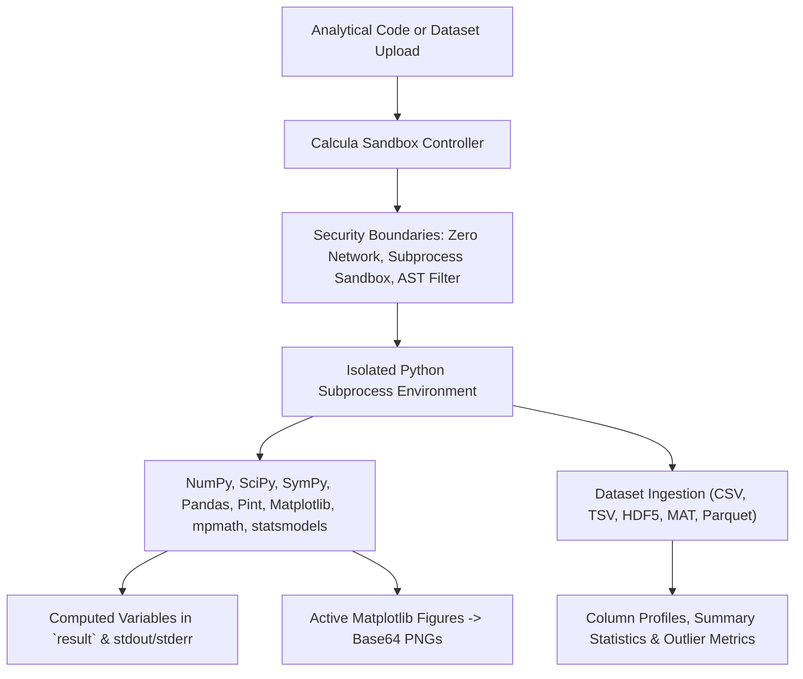

# Calcula — Sandboxed Scientific Computation & Dataset Analysis Engine

> **Tribos Computation Specialist**  
> **Made by ChronoStrider Engineering**

**Calcula** is Tribos's sandboxed scientific computing and experimental dataset analysis engine. Operating within a secure, network-isolated subprocess sandbox, Calcula executes arbitrary scientific Python code (NumPy, SciPy, SymPy, Pandas, Pint, Matplotlib, NetworkX, mpmath, and statsmodels) and automatically inspects, summarizes, and validates uploaded experimental datasets (`CSV`, `TSV`, `HDF5`, `MAT`, `Parquet`, `XLSX`).

---

## 1. Role & Architectural Overview

Calcula enables Program-Aided Language (PAL) and CodeAct execution patterns, allowing Tribos to write and execute self-contained computational scripts to perform empirical analyses, Monte Carlo simulations, signal processing, and statistical tests.



### Key Capabilities

1. **Subprocess Sandbox Security**: Runs Python code in a sandboxed subprocess without network access, subject to memory ceilings (`TRIBOS_SANDBOX_MEMORY_MB`, default 1024 MB) and wall-clock execution cutoffs (`TRIBOS_SANDBOX_TIMEOUT_S`, default 60s).
2. **Comprehensive Scientific Software Stack**: Out-of-the-box availability of NumPy, SciPy, SymPy, Pandas, Pint, Matplotlib, NetworkX, mpmath, scikit-learn, and statsmodels.
3. **Automated Dataset Profiling**: Ingests uploaded data files (`CSV`, `TSV`, `XLSX`, `Parquet`, `JSON`, `HDF5`, and `MAT`), extracting row counts, column data types, missing value percentages, distributions, and summary statistics.
4. **Program-Aided Reasoning & Plotting**: Executes custom data transforms, FFT spectral analyses, and Monte Carlo uncertainty propagations, returning open Matplotlib figures as base64-encoded PNGs.
5. **Cryptographic Provenance**: Computes SHA-256 digests over code and input dataset IDs, tagging every result with an immutable canonical ID (`comp:calcula_run_python:<hash>`).

---

## 2. Registered Tools & Schemas

### `calcula_run_python`

Executes sandboxed Python computation and analysis scripts against optional attached datasets.

- **Domain**: `analysis`
- **Adapter Type**: `LOCAL_COMPUTE`
- **Timeout**: 120.0 seconds
- **Legacy Alias**: `analysis_run_python`

#### Input Schema (`AnalysisRunInput`)

| Field | Type | Required | Default | Description |
| :--- | :--- | :--- | :--- | :--- |
| `code` | `str` | Yes | — | Python script to execute (max 20,000 characters). Assign computed output to the `result` variable. |
| `dataset_ids` | `list[str]` | No | `[]` | Optional attached dataset IDs (`ds_<12 hex>`) resolved into the script's local working directory. |
| `timeout_s` | `int` | No | `60` | Execution cutoff in seconds (5–110s). |

#### Script Environment Rules

- **Input files**: Files listed in `dataset_ids` are mapped to local filenames matching their dataset metadata.
- **Output capture**: Assign the primary return value to a global variable named `result`.
- **Graphical outputs**: Any active `plt.figure()` or `plt.plot()` calls are automatically converted into PNG images and returned in the payload.

#### Output Payload

```json
{
  "status": "ok",
  "result": {
    "mean_val": 42.08,
    "confidence_interval_95": [40.12, 44.04],
    "p_value": 0.0021
  },
  "stdout": "Loaded 10,000 samples. Iteration complete.\n",
  "stderr": "",
  "plots": [
    {
      "format": "png",
      "data_base64": "iVBORw0KGgoAAAANSUhEUgAA..."
    }
  ],
  "execution_time_seconds": 1.45,
  "canonical_id": "comp:calcula_run_python:7b91d4e2a1"
}
```

---

### `calcula_describe_dataset`

Inspects an attached dataset file and returns its dimensions, columns, data types, and descriptive statistics.

- **Domain**: `analysis`
- **Adapter Type**: `LOCAL_COMPUTE`
- **Timeout**: 30.0 seconds

#### Input Schema (`CalculaDescribeDatasetInput`)

| Field | Type | Required | Default | Description |
| :--- | :--- | :--- | :--- | :--- |
| `dataset_id` | `str` | Yes | — | Attached dataset ID matching the pattern `^ds_[0-9a-f]{12}$`. |

#### Output Payload (Tabular CSV/Parquet)

```json
{
  "dataset_id": "ds_a1b2c3d4e5f6",
  "name": "wind_tunnel_pressures.csv",
  "kind": "table",
  "n_rows": 5000,
  "n_columns": 4,
  "columns": [
    {"name": "time_s", "dtype": "float64", "missing": 0},
    {"name": "pressure_pa", "dtype": "float64", "missing": 0},
    {"name": "velocity_mps", "dtype": "float64", "missing": 3},
    {"name": "sensor_id", "dtype": "object", "missing": 0}
  ],
  "summary_statistics": {
    "pressure_pa": {
      "mean": 101325.4,
      "std": 450.2,
      "min": 99800.0,
      "25%": 101000.0,
      "50%": 101320.0,
      "75%": 101650.0,
      "max": 102900.0
    }
  },
  "head": [
    {"time_s": 0.0, "pressure_pa": 101320.0, "velocity_mps": 12.4, "sensor_id": "P1"}
  ],
  "canonical_id": "comp:calcula_describe_dataset:ds_a1b2c3d4e5f6"
}
```

#### Output Payload (Hierarchical HDF5)

```json
{
  "dataset_id": "ds_f6e5d4c3b2a1",
  "name": "cfd_simulation_grid.h5",
  "kind": "hdf5",
  "datasets": [
    {"path": "/grid/coordinates", "shape": [1000, 3], "dtype": "float64"},
    {"path": "/fields/velocity", "shape": [1000, 3], "dtype": "float32"},
    {"path": "/fields/temperature", "shape": [1000], "dtype": "float32"}
  ],
  "attributes": {
    "solver": "OpenFOAM",
    "reynolds_number": "50000"
  },
  "canonical_id": "comp:calcula_describe_dataset:ds_f6e5d4c3b2a1"
}
```

---

## 3. Integration with Tribos Reasoning Pipeline

- **Program-Aided Verification**: When an empirical verification cannot be evaluated symbolically by Axiom or analytically through Dynamis ODE presets, the agentic planner writes a self-contained Python script to verify numerical bounds.
- **Reflexion Numerical Checking**: `TribosVerifier` verifies that numbers asserted in the final report match the `result` dictionary values emitted by `calcula_run_python`.
- **Dataset Provenance**: Uploaded datasets are verified for integrity upon ingestion and cited as immutable data artifacts in final reports.

---

## 4. Concrete Usage Examples

### Example 1: Monte Carlo Uncertainty Propagation in the Sandbox

```python
from tribos.extensions.sandbox import run_calcula_python

script = """
import numpy as np

# Estimate uncertainty in beam deflection: delta = (F * L^3) / (3 * E * I)
n_samples = 100_000
F = np.random.normal(1000, 50, n_samples)      # Force in N
L = np.random.normal(2.0, 0.01, n_samples)     # Length in m
E = np.random.normal(200e9, 5e9, n_samples)    # Modulus in Pa
I = np.random.normal(1e-5, 1e-7, n_samples)    # Moment of inertia in m^4

delta = (F * L**3) / (3 * E * I)

result = {
    "mean_deflection_mm": float(np.mean(delta) * 1e3),
    "std_deflection_mm": float(np.std(delta) * 1e3),
    "p95_deflection_mm": float(np.percentile(delta, 95) * 1e3),
}
"""

out = run_calcula_python(code=script)
print("Deflection summary:", out.data["result"])
assert out.success is True
```

### Example 2: Describing an Uploaded Dataset

```python
from tribos.extensions.sandbox import describe_dataset

summary = describe_dataset(dataset_id="ds_1234567890ab")
if summary.success:
    print("Columns:", [col["name"] for col in summary.data["columns"]])
    print("Row count:", summary.data["n_rows"])
```
