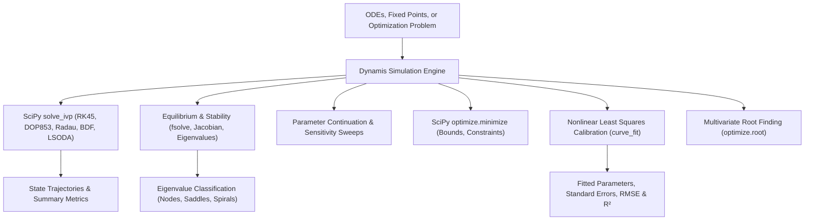

# Dynamis — Numerical Simulation, Dynamical Systems & Optimization Engine

> **Tribos Dynamics Specialist**  
> **Made by ChronoStrider Engineering**

**Dynamis** (*δύναμις* — "power, dynamic force") is Tribos's numerical simulation and dynamical systems engine. Built on SciPy and NumPy, Dynamis simulates ordinary differential equations (ODEs), computes fixed-point equilibria and Jacobian eigenvalue stability, scans parameter continuation spaces, fits physical models to calibration data, and solves nonlinear optimization problems.

---

## 1. Role & Architectural Overview

Dynamis provides quantitative numerical verification and simulation for continuous-time dynamical systems, physical models, and nonlinear processes across engineering and physics.



### Key Capabilities

1. **Stiff & Non-Stiff ODE Time-Course Integration**: Solves initial value problems using adaptive explicit (`RK45`, `DOP853`) and implicit/stiff solvers (`Radau`, `BDF`, `LSODA`).
2. **Built-in Physical & Circuit Presets**: Instant access to canonical systems: `harmonic_oscillator`, `damped_oscillator`, `lorenz`, `lotka_volterra`, `van_der_pol`, `sir`, `pendulum`, `rc_circuit`, and `rlc_circuit`.
3. **Fixed-Point & Stability Classification**: Finds equilibrium states where $f(x^*) = 0$, evaluates the exact Jacobian matrix at the fixed point, computes complex eigenvalues, and classifies stability (stable node, unstable node, saddle point, center, stable/unstable spiral).
4. **Trajectory-Wide Parameter Sweeps**: Automatically steps a physical parameter across a designated range, running complete simulations and recording final states, peaks, minima, and time-weighted means.
5. **Constrained & Unconstrained Optimization**: Minimizes or maximizes multi-variable objective functions under box bounds and equality/inequality constraints via SciPy `optimize.minimize`.
6. **Nonlinear Least Squares Calibration**: Fits constitutive model parameters to empirical observations $(x_i, y_i)$, yielding optimal coefficients, parameter covariance, standard errors, RMSE, and coefficient of determination ($R^2$).

---

## 2. Registered Tools & Schemas

### `dynamis_simulate_ode`

Simulates a custom system of differential equations $dx_i/dt = f_i(t, x; p)$ or a built-in physical model over time.

- **Domain**: `dynamis`
- **Adapter Type**: `LOCAL_COMPUTE`
- **Timeout**: 60.0 seconds

#### Input Schema (`DynamisSimulateOdeInput`)

| Field | Type | Required | Default | Description |
| :--- | :--- | :--- | :--- | :--- |
| `rhs` | `dict[str, str]` | No | `None` | Dictionary of ODE right-hand sides (e.g., `{"x": "v", "v": "-k/m * x - b/m * v"}`). |
| `initial_state` | `dict[str, float]` | No | `None` | Initial state at $t_0$ (e.g., `{"x": 1.0, "v": 0.0}`). |
| `t_span` | `tuple[float, float]` | No | `(0.0, 10.0)` | Integration time horizon `(t0, tf)`. |
| `parameters` | `dict[str, float]` | No | `None` | Numerical parameter constants (e.g., `{"k": 10.0, "m": 1.0, "b": 0.2}`). |
| `method` | `str` | No | `'RK45'` | Integration method: `'RK45'`, `'RK23'`, `'DOP853'`, `'Radau'`, `'BDF'`, `'LSODA'`. |
| `num_points` | `int` | No | `200` | Number of evaluation points across `t_span` (2–10,000). |
| `model_name` | `str` | No | `None` | Optional preset: `'lorenz'`, `'harmonic_oscillator'`, `'van_der_pol'`, `'pendulum'`, etc. |

#### Output Payload

```json
{
  "model_name": "harmonic_oscillator",
  "t_span": [0.0, 10.0],
  "num_points": 200,
  "state_variables": ["x", "v"],
  "final_state": {
    "x": -0.83907,
    "v": 0.54402
  },
  "summary_statistics": {
    "x": {"min": -1.0, "max": 1.0, "mean": -0.012},
    "v": {"min": -1.0, "max": 1.0, "mean": 0.008}
  },
  "verified": true,
  "canonical_id": "comp:dynamis_simulate_ode:b3f1201"
}
```

---

### `dynamis_equilibrium`

Locates fixed points where $dx_i/dt = 0$, computes the local Jacobian matrix, and classifies orbital stability.

- **Domain**: `dynamis`
- **Adapter Type**: `LOCAL_COMPUTE`
- **Timeout**: 60.0 seconds

#### Input Schema (`DynamisEquilibriumInput`)

| Field | Type | Required | Default | Description |
| :--- | :--- | :--- | :--- | :--- |
| `rhs` | `dict[str, str]` | Yes | — | Right-hand side differential equations. |
| `guess` | `dict[str, float]` | Yes | — | Initial guess coordinates for the equilibrium search. |
| `parameters` | `dict[str, float]` | No | `None` | Fixed numeric parameters. |

#### Output Payload

```json
{
  "fixed_point": {"x": 0.0, "v": 0.0},
  "jacobian": [
    [0.0, 1.0],
    [-10.0, -0.2]
  ],
  "eigenvalues": [
    {"real": -0.1, "imag": 3.1607},
    {"real": -0.1, "imag": -3.1607}
  ],
  "classification": "stable_spiral",
  "asymptotically_stable": true,
  "canonical_id": "comp:dynamis_equilibrium:9c41a02"
}
```

---

### `dynamis_parameter_scan`

Sweeps a parameter across a designated interval to generate bifurcation curves and parameter-response profiles.

- **Domain**: `dynamis`
- **Adapter Type**: `LOCAL_COMPUTE`
- **Timeout**: 60.0 seconds

#### Input Schema (`DynamisParameterScanInput`)

| Field | Type | Required | Default | Description |
| :--- | :--- | :--- | :--- | :--- |
| `rhs` | `dict[str, str]` | Yes | — | Right-hand side equations. |
| `initial_state` | `dict[str, float]` | Yes | — | Initial state conditions. |
| `parameter` | `str` | Yes | — | Name of the parameter to sweep. |
| `scan_range` | `tuple[float, float]` | Yes | — | Tuple `(min_val, max_val)` for the sweep. |
| `num_points` | `int` | No | `10` | Evaluation steps across the scan range (2–200). |
| `t_span` | `tuple[float, float]` | No | `(0.0, 10.0)` | Integration time horizon per parameter point. |
| `base_parameters` | `dict[str, float]` | No | `None` | Fixed base values for remaining parameters. |

#### Output Payload

```json
{
  "parameter": "k",
  "parameter_values": [1.0, 3.25, 5.5, 7.75, 10.0],
  "responses": {
    "x_final": [0.54, 0.12, -0.45, -0.89, 0.23],
    "x_max": [1.0, 1.0, 1.0, 1.0, 1.0]
  },
  "canonical_id": "comp:dynamis_parameter_scan:17a8c91"
}
```

---

### `dynamis_optimize`

Solves single-objective numerical optimization problems under variable bounds and constraints.

- **Domain**: `dynamis`
- **Adapter Type**: `LOCAL_COMPUTE`
- **Timeout**: 60.0 seconds

#### Input Schema (`DynamisOptimizeInput`)

| Field | Type | Required | Default | Description |
| :--- | :--- | :--- | :--- | :--- |
| `objective` | `str` | Yes | — | Objective function expression to optimize (e.g., `"(x - 3)^2 + (y + 2)^2"`). |
| `variables` | `list[str]` | Yes | — | Ordered list of optimization variable names. |
| `bounds` | `dict` | No | `None` | Box bounds mapping variable names to `(lower, upper)`. |
| `initial_guess` | `dict[str, float]` | No | `None` | Starting point coordinates. |
| `constraints` | `list[dict]` | No | `None` | Constraints list, each `{"type": "eq"|"ineq", "expr": "..."}`. |
| `minimize` | `bool` | No | `True` | `True` to minimize, `False` to maximize. |

#### Output Payload

```json
{
  "optimal_variables": {"x": 3.0, "y": -2.0},
  "optimal_value": 0.0,
  "success": true,
  "iterations": 5,
  "canonical_id": "comp:dynamis_optimize:d102e45"
}
```

---

### `dynamis_fit_parameters`

Fits nonlinear models to experimental observations $(x, y)$ using nonlinear least-squares regression.

- **Domain**: `dynamis`
- **Adapter Type**: `LOCAL_COMPUTE`
- **Timeout**: 60.0 seconds

#### Input Schema (`DynamisFitParametersInput`)

| Field | Type | Required | Default | Description |
| :--- | :--- | :--- | :--- | :--- |
| `model_expr` | `str` | Yes | — | Model equation (e.g., `'a * exp(-b * t) + c'`). |
| `independent_var` | `str` | Yes | — | Independent variable name (e.g., `'t'`). |
| `param_names` | `list[str]` | Yes | — | Parameters to estimate (e.g., `["a", "b", "c"]`). |
| `x_data` | `list[float]` | Yes | — | Observed independent data values. |
| `y_data` | `list[float]` | Yes | — | Observed dependent data values. |
| `initial_guess` | `dict[str, float]` | No | `None` | Optional initial parameter guesses. |

#### Output Payload

```json
{
  "fitted_parameters": {
    "a": 5.012,
    "b": 0.498,
    "c": 1.002
  },
  "standard_errors": {
    "a": 0.034,
    "b": 0.007,
    "c": 0.015
  },
  "rmse": 0.021,
  "r_squared": 0.9994,
  "canonical_id": "comp:dynamis_fit_parameters:5c91b11"
}
```

---

### `dynamis_root_find`

Finds numerical roots for coupled nonlinear algebraic equations using SciPy `optimize.root`.

- **Domain**: `dynamis`
- **Adapter Type**: `LOCAL_COMPUTE`
- **Timeout**: 60.0 seconds

#### Input Schema (`DynamisRootFindInput`)

| Field | Type | Required | Default | Description |
| :--- | :--- | :--- | :--- | :--- |
| `equations` | `str \| list[str]` | Yes | — | Nonlinear equation(s) to solve for zero (e.g., `["x^2 + y^2 - 25", "x - y - 1"]`). |
| `initial_guess` | `dict[str, float]` | Yes | — | Initial numerical starting guess per variable. |
| `parameters` | `dict[str, float]` | No | `None` | Fixed numeric parameters. |

#### Output Payload

```json
{
  "roots": {"x": 4.0, "y": 3.0},
  "residual_norm": 1.4e-14,
  "converged": true,
  "canonical_id": "comp:dynamis_root_find:88b12f0"
}
```

---

## 3. Integration with Tribos Reasoning Pipeline

- **Stage 2 Numerical Execution**: Dynamis executes after Stage 1 literature/constants retrieval when questions require numerical solutions, trajectories, or parameter optimization.
- **Reflexion Numerical Auditing**: Verification hooks cross-check claimed steady-state values and trajectory bounds against Dynamis numerical logs.
- **Safety Policy**: Simulations exceeding 3600 seconds are rejected upfront (`DURATION_OUT_OF_RANGE`), and literature-only questions bypass Dynamis automatically.

---

## 4. Concrete Usage Examples

### Example 1: Simulating a Van der Pol Oscillator

```python
from tribos.dynamis.engine import dynamis_simulate_ode

sim = dynamis_simulate_ode(
    rhs={"x": "v", "v": "mu * (1 - x^2) * v - x"},
    initial_state={"x": 2.0, "v": 0.0},
    t_span=(0.0, 20.0),
    parameters={"mu": 1.0},
    num_points=500,
)
print("Final state:", sim["final_state"])
assert sim["verified"] is True
```

### Example 2: Non-Linear Least Squares Parameter Fitting

```python
from tribos.dynamis.engine import dynamis_fit_parameters

fit = dynamis_fit_parameters(
    model_expr="A * sin(omega * t)",
    independent_var="t",
    param_names=["A", "omega"],
    x_data=[0.0, 0.5, 1.0, 1.5, 2.0, 2.5, 3.14159],
    y_data=[0.0, 0.95, 0.28, -0.84, -0.76, 0.42, 0.0],
    initial_guess={"A": 1.0, "omega": 2.0},
)
print(f"Fitted A={fit['fitted_parameters']['A']:.2f}, omega={fit['fitted_parameters']['omega']:.2f}")
print(f"R²: {fit['r_squared']:.4f}")
```
