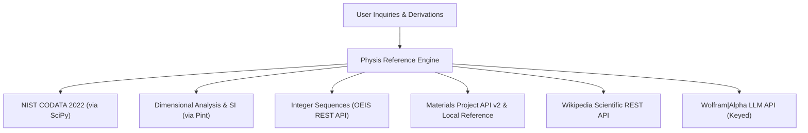

# Physis — Physical Constants, Units, OEIS & Materials Reference Engine

> **Tribos Reference Specialist**  
> **Made by ChronoStrider Engineering**

**Physis** (*φύσις* — "nature, physical reality") is Tribos's authoritative scientific reference engine for physical constants, unit conversions, dimensional homogeneity verification, integer sequences, materials properties, and encyclopedic scientific concepts.

---

## 1. Role & Architectural Overview

Physis acts as the empirical grounding engine for Tribos, ensuring calculations and theoretical derivations are anchored in verified fundamental constants, correct physical dimensions, and established materials data.



### Key Capabilities

1. **Exact Fundamental Physical Constants**: Direct access to NIST CODATA 2022 constants (speed of light, Planck constant, gravitational constant, elementary charge, Rydberg constant, etc.) with physical units and standard uncertainties.
2. **Dimensional Analysis & Unit Conversions**: Complete SI and non-SI conversion using Pint, including dimensional homogeneity checks of analytical equations ($[M^a L^b T^c I^d \Theta^e N^f J^g]$).
3. **Integer Sequences (OEIS)**: Automated query of the On-Line Encyclopedia of Integer Sequences by A-number, term sequences, or combinatorial concepts.
4. **Materials Science Properties**: Electronic, structural, and mechanical properties via Materials Project API v2 (band gaps, crystal systems, density) backed by a 25-material curated engineering reference table.
5. **Encyclopedic Grounding**: Real-time retrieval of mathematical definitions, physical laws, and theorems from Wikipedia.
6. **Computational Fact Checking**: Optional Wolfram|Alpha querying when `TRIBOS_WOLFRAM_APPID` is configured.

---

## 2. Registered Tools & Schemas

### `physis_constants`

Looks up exact NIST CODATA 2022 physical constants, symbols, units, and uncertainties.

- **Domain**: `physis`
- **Adapter Type**: `LOCAL_COMPUTE`
- **Timeout**: 10.0 seconds

#### Input Schema (`PhysisConstantsInput`)

| Field | Type | Required | Default | Description |
| :--- | :--- | :--- | :--- | :--- |
| `query` | `str` | Yes | — | Physical constant name, symbol, or keyword (e.g., `'Planck constant'`, `'c'`, `'hbar'`, `'Boltzmann'`, `'fine-structure'`). |
| `limit` | `int` | No | `10` | Maximum number of matching CODATA constants to return (1–50). |

#### Output Payload

```json
{
  "query": "Planck constant",
  "matches": [
    {
      "name": "Planck constant",
      "symbol": "h",
      "value": 6.62607015e-34,
      "unit": "J s",
      "uncertainty": 0.0,
      "exact": true
    },
    {
      "name": "Planck constant in eV s",
      "symbol": "h",
      "value": 4.135667696e-15,
      "unit": "eV s",
      "uncertainty": 0.0,
      "exact": true
    }
  ],
  "canonical_id": "nist:planck_constant"
}
```

---

### `physis_units`

Converts physical quantities between units, reduces expressions to base SI units, and verifies dimensional homogeneity across equations.

- **Domain**: `physis`
- **Adapter Type**: `LOCAL_COMPUTE`
- **Timeout**: 10.0 seconds

#### Input Schema (`PhysisUnitsInput`)

| Field | Type | Required | Default | Description |
| :--- | :--- | :--- | :--- | :--- |
| `value` | `float` | No | `1.0` | Numerical magnitude of the physical quantity. |
| `from_unit` | `str` | No | `""` | Source unit expression (e.g., `'eV'`, `'kcal/mol'`, `'GPa'`, `'N * m'`). |
| `to_unit` | `str` | No | `None` | Target unit expression (e.g., `'J'`, `'kJ/mol'`, `'Pa'`). Omit to reduce to base SI units. |
| `check_equation` | `str` | No | `None` | Optional equation `'lhs = rhs'` (e.g., `'kg * m / s^2 = N'`) to verify dimensional homogeneity. |

#### Output Payload

```json
{
  "value": 1.0,
  "from_unit": "eV",
  "to_unit": "J",
  "converted_value": 1.602176634e-19,
  "base_si": "1.602176634e-19 kg * m ** 2 / s ** 2",
  "dimensionality": "[length] ** 2 * [mass] / [time] ** 2",
  "compatible": true
}
```

When verifying an equation (`check_equation="kg * m / s^2 = N"`):
```json
{
  "check_equation": "kg * m / s^2 = N",
  "homogeneous": true,
  "lhs_dimensionality": "[length] * [mass] / [time] ** 2",
  "rhs_dimensionality": "[length] * [mass] / [time] ** 2"
}
```

---

### `physis_oeis`

Queries the On-Line Encyclopedia of Integer Sequences (OEIS) by A-number, initial terms, or keyword.

- **Domain**: `physis`
- **Adapter Type**: `DIRECT_REST`
- **Timeout**: 15.0 seconds

#### Input Schema (`PhysisOeisInput`)

| Field | Type | Required | Default | Description |
| :--- | :--- | :--- | :--- | :--- |
| `query` | `str` | Yes | — | OEIS sequence query: A-number (e.g. `'A000045'`), comma-separated terms (e.g. `'1, 1, 2, 5, 14, 42'`), or keyword. |
| `limit` | `int` | No | `5` | Maximum number of sequences to return (1–25). |

#### Output Payload

```json
{
  "query": "A000045",
  "results": [
    {
      "number": 45,
      "id": "A000045",
      "name": "Fibonacci numbers: F(n) = F(n-1) + F(n-2) with F(0) = 0 and F(1) = 1.",
      "data": "0,1,1,2,3,5,8,13,21,34,55,89,144,233,377,610,987,1597",
      "formula": ["F(n) = ((1+sqrt(5))^n - (1-sqrt(5))^n)/(2^n*sqrt(5))"],
      "comments": ["Also called Hemachandra numbers."]
    }
  ],
  "canonical_id": "oeis:A000045"
}
```

---

### `physis_materials`

Retrieves crystalline, electronic, mechanical, and thermal properties of materials from the Materials Project API v2 and curated reference tables.

- **Domain**: `physis`
- **Adapter Type**: `DIRECT_REST`
- **Timeout**: 15.0 seconds

#### Input Schema (`PhysisMaterialsInput`)

| Field | Type | Required | Default | Description |
| :--- | :--- | :--- | :--- | :--- |
| `formula` | `str` | No | `None` | Chemical formula or material name (e.g., `'Si'`, `'GaAs'`, `'TiO2'`, `'Silicon'`). |
| `material_id` | `str` | No | `None` | Materials Project ID (e.g., `'mp-149'`, `'mp-2534'`). |
| `elements` | `list[str]` | No | `None` | List of required chemical elements (e.g., `['Ga', 'N']`). |
| `query` | `str` | No | `None` | General material search query. |
| `limit` | `int` | No | `5` | Maximum number of materials to return (1–25). |

#### Output Payload

```json
{
  "query": "GaAs",
  "materials": [
    {
      "material_id": "mp-2534",
      "formula_pretty": "GaAs",
      "crystal_system": "cubic",
      "spacegroup": "F-43m",
      "band_gap_ev": 1.42,
      "density_g_cm3": 5.32,
      "is_gap_direct": true,
      "thermal_conductivity_w_m_k": 55.0
    }
  ],
  "canonical_id": "mp:mp-2534"
}
```

---

### `physis_wolfram`

Queries the Wolfram|Alpha LLM API for external mathematical, physical, or engineering facts when `TRIBOS_WOLFRAM_APPID` is configured.

- **Domain**: `physis`
- **Adapter Type**: `DIRECT_REST`
- **Timeout**: 20.0 seconds

#### Input Schema (`PhysisWolframInput`)

| Field | Type | Required | Default | Description |
| :--- | :--- | :--- | :--- | :--- |
| `query` | `str` | Yes | — | Natural-language or symbolic query for the Wolfram|Alpha API. |

---

### `physis_encyclopedia`

Searches the Wikipedia REST API for definitions, theorems, and concepts across mathematics, physics, and engineering.

- **Domain**: `physis`
- **Adapter Type**: `DIRECT_REST`
- **Timeout**: 15.0 seconds

#### Input Schema (`PhysisEncyclopediaInput`)

| Field | Type | Required | Default | Description |
| :--- | :--- | :--- | :--- | :--- |
| `query` | `str` | Yes | — | Concept, theorem name, or physical law to search. |
| `limit` | `int` | No | `3` | Maximum entries to return (1–10). |

---

### `physis_molecule`

Exact structure facts for organic molecules given as SMILES, computed with RDKit (`tribos/physis/chemistry.py`).

- **Domain**: `physis`
- **Adapter Type**: `LOCAL_COMPUTE`
- **Timeout**: 30.0 seconds

| Field | Type | Required | Default | Description |
| :--- | :--- | :--- | :--- | :--- |
| `smiles` | `list[str]` | Yes | — | One to eight structures as SMILES. Atom-map numbers may carry IUPAC locants. |
| `names` | `list[str]` | No | — | A short name for each structure, such as the answer options. |
| `locants` | `dict[str, str]` | No | — | Atom-map number to locant label for letter locants, e.g. `{"31": "3a"}`. |

For each structure it returns:

- the molecular formula, molecular weight and monoisotopic mass;
- the degree of unsaturation;
- the stereocentres and stereogenic double bonds with CIP labels (new CIP labeler, pseudoasymmetric r/s included);
- whether the structure is chiral or meso;
- the number of stereoisomers of its constitution, split into enantiomer pairs and achiral forms;
- the number of topologically distinct H and C environments.

For each pair of structures it says whether they are identical, enantiomers, diastereomers or constitutional isomers.
Environments are graph-symmetry classes, so diastereotopic CH2 protons count as one class.

It also gives the molecular point group (`tribos/physis/symmetry.py`):

1. Up to 12 conformers are embedded and relaxed with MMFF (UFF when MMFF has no parameters); the lowest is kept.
2. Candidate rotation axes and mirror planes are tested against the atoms within 0.3 Å.
3. The Schoenflies group follows the standard decision chart.

Three groups are reported: that of the relaxed conformer, that of its heavy-atom framework, and the most symmetric one
within 1.5 kcal/mol. A flexible molecule such as stilbene twists in its minimum (Ci) but is planar (C2h) close by.
Structures without force-field parameters, such as hypervalent centres, get no group rather than a wrong one.

### `physis_stereo`

Translates stereodescriptor sets into 3D geometry. A model that has a product's geometry right can still write the
wrong R/S labels. This tool is how Tribos avoids that.

| Field | Type | Required | Default | Description |
| :--- | :--- | :--- | :--- | :--- |
| `smiles` | `list[str]` | Yes | — | With `descriptor_sets`: one SMILES of the constitution, atoms mapped to their locants. Without: isomeric SMILES to describe. |
| `descriptor_sets` | `list[str]` | No | — | e.g. `["(1R,2S)", "(1R,2R)"]` or whole names; R/S, r/s and E/Z. |
| `locants` | `dict[str, str]` | No | — | Atom-map number to locant label for letter locants. |
| `distance_pairs` | `list[list[str]]` | No | — | Locant pairs whose 3D distance to report. |

How it works:

1. Each descriptor set is assigned with the CIP rules. Mismatched centres are flipped until the labels hold; if that
   does not settle, an exhaustive search over up to 2^12 assignments follows.
2. The configuration is embedded in 3D (ETKDG with MMFF relaxation). The tool checks that the geometry keeps the
   labels.
3. For every ring that holds two or more stereocentres, it lists the substituents on each face of the ring's mean
   plane, with cis/trans for each pair.

In a bridged bicycle, a substituent on the same face of the ring through both bridgeheads as the other bridge is endo
to that bridge.

Both tools are planned for questions that turn on a structure: stereodescriptors in names, stereoisomers, chirality,
NMR environments, molecular formulae, endo/exo (`is_structure_question`). The result reaches the writer as a
`<chemistry>` evidence block.

A planner transcribing names into SMILES is unreliable. In live runs it dropped substituents and left out locant
numbers. So for a choose-one question whose options are named with stereodescriptors, code builds the structures
itself before drafting:

1. `tribos/physis/names.py` parses each option's name into a locant-numbered structure.
2. `compute_option_stereo` translates each option's descriptors into ring faces.
3. The result is stored under the `chemistry` result key. The planner is then not offered `physis_stereo`.

Options given as SMILES are numbered by the canonical order of their shared constitution, so `#k` is the same atom in
every option, and the centres whose labels differ are listed.

The name grammar covers substituted chains, carbocycles, von Baeyer bicycles and monospiro systems:

- C1 to C12 parents, `bicyclo[a.b.c]` and `spiro[a.b]`, with -ene/-yne locants;
- skeletal replacement: `oxa`, `aza`, `thia`;
- the suffixes -ol, -one, -amine, -thiol and -al;
- alkyl, halo, hydroxy, alkoxy, nitro, amino, oxo and similar prefixes.

Fused ring names (such as "methanoisobenzofuran") and aromatic parents return nothing. Those are left to a planned
tool call.

---

## 3. Practical Usage Examples

### Example 1: Verifying Dimensional Homogeneity of Kinetic Energy

```python
from tribos.physis.engine import PhysisEngine

engine = PhysisEngine()
result = engine.convert_units(
    check_equation="0.5 * (10 kg) * (5 m / s)^2 = 125 J"
)
assert result["homogeneous"] is True
```

### Example 2: Looking up CODATA Constants for Quantum Hall Effect

```python
from tribos.physis.engine import PhysisEngine

engine = PhysisEngine()
constants = engine.lookup_constants(query="von Klitzing")
# Returns exact value R_K = h / e^2 = 25812.80745... Ohm
```

### Example 3: Searching Integer Sequences

```python
import asyncio
from tribos.physis.engine import PhysisEngine

async def main():
    engine = PhysisEngine()
    catalan = await engine.lookup_oeis("1, 1, 2, 5, 14, 42, 132")
    print(catalan["results"][0]["name"])  # Catalan numbers: C(n) = binomial(2n,n)/(n+1)

asyncio.run(main())
```
